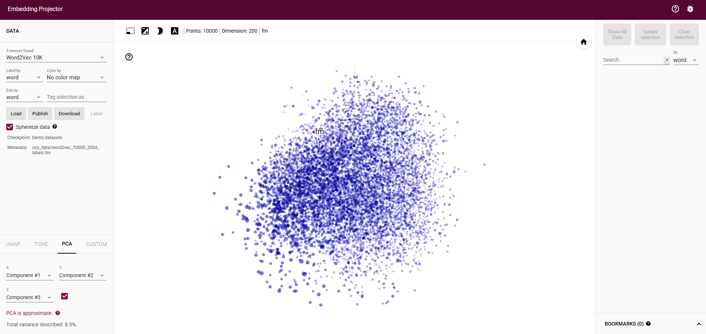

<p align="center"><a href="README.md">Español</a> · <b>English</b></p>

# Vector Explorer

Vector Explorer is an interactive tool for exploring and visualizing embeddings from natural language processing (NLP) models. The application makes it easy to extract embeddings for the full vocabulary of different models and visualize them in TensorBoard.

## 🎯 Purpose and Use Cases

This tool can be especially useful for:

### Research and Analysis

- **Semantic Analysis**: Explore semantic relationships between words and concepts
- **Model Evaluation**: Compare different embedding models and their quality
- **Bias Analysis**: Identify possible biases in language models
- **Linguistic Research**: Study lexical relationships and semantic fields

### Development and Applications

- **Model Selection**: Helps you choose the most suitable model for your application
- **Embedding Optimization**: Analyze and improve vector representations
- **Chatbot Development**: Improve natural language processing systems
- **Search Systems**: Implement more accurate semantic searches

### Education and Visualization

- **Teaching NLP**: A teaching tool for understanding embeddings
- **Visual Demonstration**: Show how words relate to each other in vector space
- **Experimentation**: Make it easier to experiment with different models
- **Documentation**: Generate visualizations for documentation and presentations

## 🌟 Features

- **Embedding Extraction**: Extracts embeddings for the full vocabulary of different pretrained models.
- **Interactive Visualization**: TensorBoard integration to visualize the embeddings in three-dimensional space.
- **Friendly CLI**: Interactive command-line interface for ease of use.

## 👀 Recommended video

- [DotCSV - ¿Qué es Word2Vec? (YouTube)](https://youtu.be/RkYuH_K7Fx4) (in Spanish)

## 📄 Original Word2Vec paper

- [Word2Vec: Efficient Estimation of Word Representations in Vector Space (Mikolov et al., 2013)](https://arxiv.org/pdf/1301.3781)

## 🛠️ Project Structure

```
vector-explorer/
├── config/
│   └── config.json          # Project configuration
├── embeddings_output/       # Directory where embeddings are saved
│   ├── metadata.tsv
│   ├── projector_config.pbtxt
│   └── tensor.tsv
├── src/
│   ├── cli/
│   │   └── interactive.py   # Command-line interface
│   ├── models/
│   │   ├── embedding_writer.py  # Embedding writing management
│   │   └── model_manager.py     # Model management
│   └── utils/
│       ├── config.py        # Configuration utilities
│       └── tensorboard.py   # TensorBoard management
└── requirements.txt         # Project dependencies
```

## 📋 Requirements

- Python 3.11 or later
- TensorFlow and TensorBoard
- PyTorch
- Transformers (Hugging Face)

## 🚀 Installation

1. Clone the repository:

```bash
git clone https://github.com/virtuanista/vector-explorer.git
cd vector-explorer
```

2. Create a virtual environment (recommended):

```bash
python -m venv myenv
```

3. Install the dependencies:

```bash
pip install -r requirements.txt
```

## 💻 Usage

1. Activate the virtual environment:

```bash
.\myenv\Scripts\activate
```

2. Run the application:

```bash
python main.py
```

3. Select a menu option:
   - **Extraer embeddings** (Extract embeddings): Extracts the embeddings for the full vocabulary of the selected model
   - **Visualizar embeddings existentes** (Visualize existing embeddings): Opens TensorBoard to visualize previously extracted embeddings
   - **Salir** (Exit): Closes the application

## 📊 Visualizing Embeddings

After extracting the embeddings, TensorBoard starts automatically. You can access the visualization at:

```
http://localhost:6006
```

In TensorBoard you can:

- View the embeddings in 3D
- Search for specific words
- Analyze semantic relationships between words
- Explore clusters of similar words



## 📁 Generated Files

- **tensor.tsv**: Contains the embedding vectors
- **metadata.tsv**: Contains the corresponding tokens
- **projector_config.pbtxt**: TensorBoard configuration

## 📬 Contact

- If you have any questions or need help, we can connect on [Linkedin](https://www.linkedin.com/in/virtuanista/).
- If you want to share the project: [https://github.com/virtuanista/vector-explorer](https://github.com/virtuanista/vector-explorer)
- Wiki [Direct link](https://deepwiki.com/virtuanista/vector-explorer).

## 📄 License

<p align="center">
	Repository made by <a href="https://github.com/virtuanista" target="_blank">virtu 🎣</a>
</p>

<p align="center">
	
</p>

<p align="center">
	Copyright © 2025
</p>

<p align="center">
	<a href="/LICENSE"></a>
</p>
